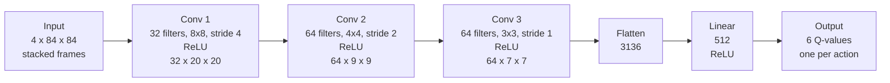
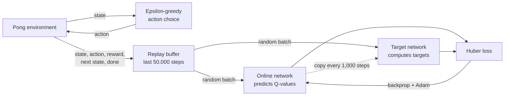
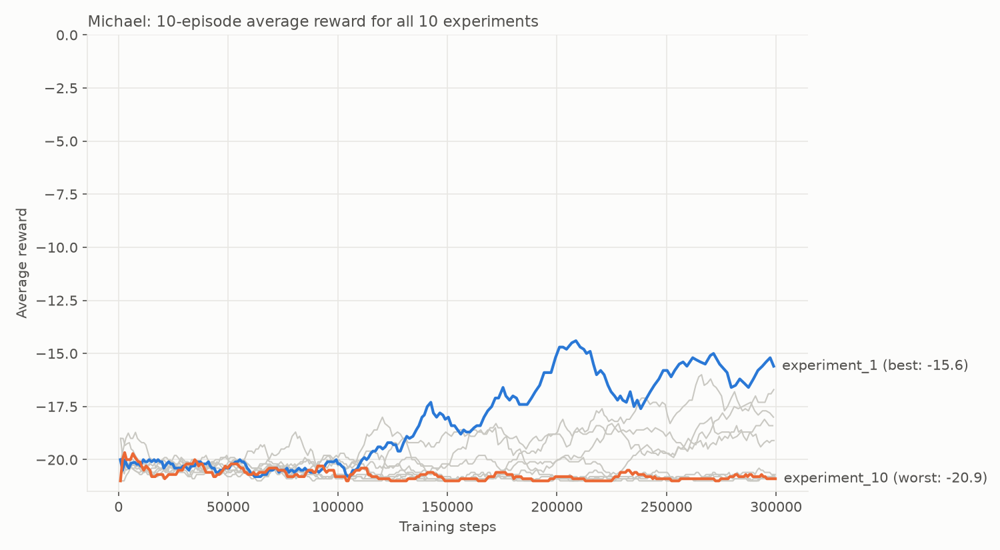
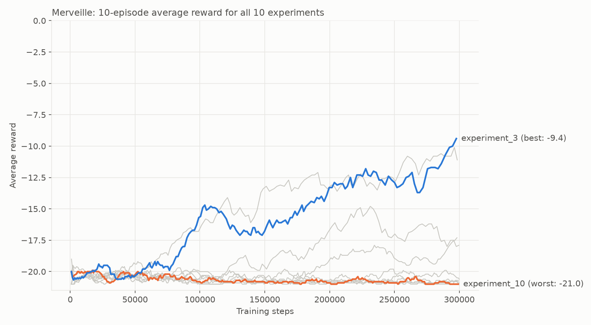
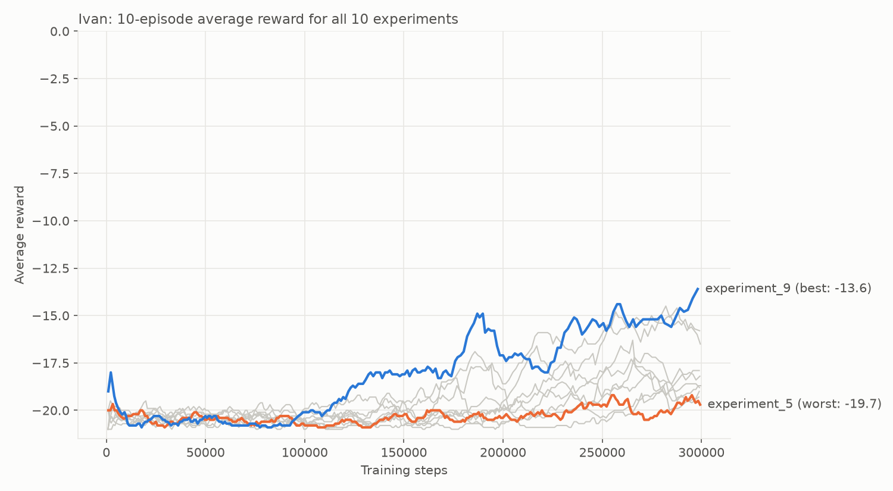
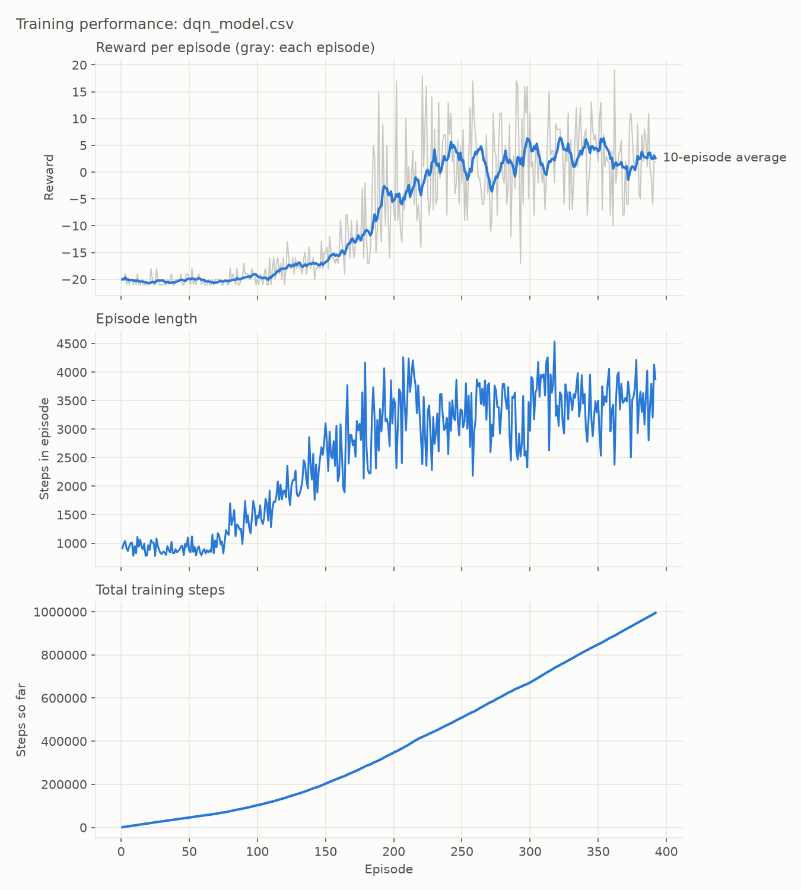

# Deep Q Learning: Pong

ALU Machine Learning, Year 3 Trimester 2, Formative 3 Assignment.

We built a Deep Q-Network (DQN) from scratch with PyTorch and Gymnasium and trained it to play Atari Pong. No ready-made RL library was used.

## 1. Project Introduction

**Group members**

- Michael Nwuju
- Merveille Munana
- Ivan Manzi

**Selected environment:** `ALE/Pong-v5` from the [Gymnasium Atari collection](https://ale.farama.org/environments/pong/).

In Pong, the agent controls the right paddle and plays against the built-in computer opponent. It gets +1 for every point it wins and -1 for every point it loses, and a game ends when one side reaches 21 points. So an episode score goes from -21 (lost every point) to +21 (won every point). A random agent scores about -19.8.

**Result:** our final agent won 16 of its last 20 training games, with an average score of +2.6 over its last 10.

## 2. DQN Architecture

### Preprocessing

Each raw Atari frame is 210x160 in colour. Before the network sees it, `environment.py` converts it to grayscale, resizes it to 84x84 and stacks the last 4 frames together. One frame cannot show which way the ball is moving, but 4 frames in a row can. The agent also repeats each action for 4 frames, which makes training about 4 times faster.

### Q-Network

The network takes the 4 stacked frames and outputs one Q-value for each of Pong's 6 actions. A Q-value is the network's guess of the total future reward it will get if it takes that action now. The agent picks the action with the highest Q-value.



The three convolution layers learn to find shapes in the frames, like the ball and the paddles. The two linear layers turn those shapes into a Q-value for each action. Pixel values are divided by 255 so they go from 0 to 1.

### Training process



`train.py` repeats these steps:

1. **Choose an action with epsilon-greedy.** With probability epsilon the agent picks a random action (exploring). Otherwise it picks the action with the highest Q-value (exploiting). Epsilon starts at 1.0, so the agent is fully random, and drops in a straight line to a small value, so over time it relies more and more on what it has learnt.
2. **Store the experience.** Each step is saved in the replay buffer as (state, action, reward, next state, done). The buffer keeps the last 50,000 steps.
3. **Learn from a random batch.** Every 4 steps, once the buffer has 10,000 steps, the agent samples a random batch from the buffer. Sampling randomly breaks up runs of very similar frames, which makes learning more stable.
4. **Compute the target with the Bellman equation.** For each sampled step:

   `target = reward + gamma * (highest Q-value of the next state, from the target network)`

   If the game ended on that step, the target is just the reward, because there is no future. Gamma (0.99) controls how much the agent cares about rewards further in the future.

5. **Update the online network.** The loss is the Huber loss between the online network's Q-value for the action taken and the target. Huber loss acts like squared error for small mistakes and like absolute error for big ones, so a few very wrong targets cannot knock training off course. Backpropagation and the Adam optimizer then update the online network's weights.
6. **Update the target network.** Every 1,000 steps, the online network's weights are copied into the target network. Keeping the target network fixed in between means the targets do not move every time the online network changes, which keeps training stable.

Each episode's reward, length and total steps are written to a CSV log, and the final weights are saved as a `.pth` file.

### Final hyperparameters

Chosen by combining the best setting from each member's experiments:

| Hyperparameter        | Value             | From                    |
| --------------------- | ----------------- | ----------------------- |
| Learning rate         | 0.0001            | Michael's experiments   |
| Gamma                 | 0.99              | Michael's experiments   |
| Batch size            | 128               | Merveille's experiments |
| Epsilon start         | 1.0               | Ivan's experiments      |
| Epsilon end           | 0.01              | Ivan's experiments      |
| Epsilon decay         | 50,000 steps      | Ivan's experiments      |
| Training steps        | 1,000,000         |                         |
| Replay buffer size    | 50,000            |                         |
| Target network update | every 1,000 steps |                         |

## 3. Results

### Hyperparameter experiments

Each member ran 10 experiments of 300,000 steps each. The full tables are in:

- [Michael_Hyperparameter_experiment_results.md](Michael_Hyperparameter_experiment_results.md): learning rate and gamma
- [Merveille_Hyperparameter_experiment_results.md](Merveille_Hyperparameter_experiment_results.md): batch size
- [Ivan_Hyperparameter_experiment_results.md](Ivan_Hyperparameter_experiment_results.md): exploration (epsilon)

The models and logs for every experiment are in `models/<member>/`.

| Member    | Best run                               | Main finding                                                       |
| --------- | -------------------------------------- | ------------------------------------------------------------------ |
| Michael   | -15.6 (baseline)                       | Learning rates of 0.00025 and higher broke learning completely     |
| Merveille | -9.4 (batch 128)                       | Bigger batches made learning much steadier, up to 128              |
| Ivan      | -13.6 (epsilon to 0.01 over 50k steps) | Short exploration with almost no randomness at the end worked best |







### Final training run

Training the final settings for 1,000,000 steps took the agent from about -20 to winning most games. Episode length grew from about 900 to about 3,500 steps, because a better agent returns the ball more, so the games last longer.



## 4. How to Run

This project uses [uv](https://docs.astral.sh/uv/).

```bash
uv sync

uv run python random_agent.py
uv run python train.py
uv run python play.py
uv run python plot_results.py
```

`train.py` takes the hyperparameters as flags, for example:

```bash
uv run python train.py --learning-rate 0.0001 --batch-size 128 --epsilon-end 0.01 --epsilon-decay-steps 50000 --total-steps 1000000
```

`play.py` loads `dqn_model.pth` by default. To watch any experiment instead:

```bash
uv run python play.py --model models/merveille/experiment_3.pth --episodes 3
```

The experiments were run on a Google Colab GPU with `colab_experiments.ipynb`.

## 5. Task Allocation

| Member        | Task                                                                                                                                                            |
| ------------- | --------------------------------------------------------------------------------------------------------------------------------------------------------------- |
| Michael Nwuju | Task 2: `train.py` (Q-network, replay buffer, epsilon-greedy, Bellman update, target network), project setup with uv, Colab notebook, plots, final training run |
| Merveille Munana | Task 1: environment selection and preprocessing (`environment.py`), random agent baseline (`random_agent.py`)                                                |
| Manzi Ivan    | Task 3: `play.py` (loading the model and playing greedily in real time)                                                                                         |

Every member ran and documented 10 hyperparameter experiments. See `Task allocation sheet.pdf` for the full breakdown.

## 6. Gameplay Demonstration

**[Watch the trained agent play Pong](https://canva.link/31uhncyxx13hxgr)**

The video shows `play.py` running the final `dqn_model.pth` with greedy actions.
